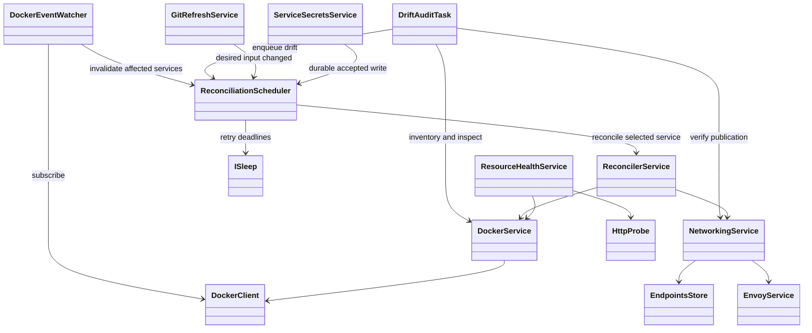

# Event-driven reconciliation implementation handoff

Status: all six tasks implemented, merged locally, and validated. This is an implementation handoff and task record, not a replacement for the authoritative platform requirements.

## Objective and authorization

Replace frequent global reconciliation with Docker events and a slow safety audit. Preserve automatic repair of supported drift, including manual Docker stops. Reduce repeated Docker queries, YAML work, state writes, and Envoy publication without weakening deployment readiness, ownership checks, retry recovery, or secret handling.

The owner requested a new GPT-6.1 Sol chat at medium reasoning to use the `swarm` skill to split up and implement this handoff. Follow that skill's work-unit planning and confirmation requirements before starting implementation workers. This handoff approves the technical direction; it is not confirmation of an as-yet-unpresented swarm grouping.

Read root/scoped AGENTS.md, architecture, reconciliation/deployments, development, configuration, networking/auth, and management UI documents as relevant. Use the repository TypeScript and layered-architecture skills. Use apply_patch for edits, run nvm use from the repository root before Node ecosystem commands, and request approval before adding dependencies.

## Baseline evidence and boundaries

- CPU attribution is unconfirmed: no CPU profile was captured. Do not claim a measured performance improvement without evidence.
- Before implementation, start.ts ran reconciliation every five seconds and resource-health/cache refresh every 30 seconds. Git refresh defaulted to 300 seconds.
- The unchanged web path in WebResourceReconciler still prepares networking and calls NetworkingService.routeTo. That writes endpoint state and rebuilds the full Envoy configuration. EnvoyClient.publish writes CDS/LDS YAML and checks config_dump even for identical resource versions.
- ResourceHealthService and management snapshots perform overlapping observations. ReconcilerService writes checkpoints and publishes changes during unchanged successful passes.
- Specification labels record requested configuration; they are not independent verification of every mutable live setting. Do not promise detection of arbitrary host filesystem or in-container drift.

## Original implementation tasks

These six identifiers are the original tasks for the swarm ledger. Preserve their scope when grouping work.

### T1: Docker event subscription

- Now: Docker changes are discovered through five-second reconciliation and 30-second observation. After: subscribe through the existing Docker Engine client/transport boundary to container lifecycle/update events and network connect/disconnect/create/destroy events relevant to owned infrastructure and workloads.
- Add a DockerEventWatcher (proposed name) which maps events to affected services and marks them dirty. Treat events as invalidation hints; re-observe current state before repair. Include infrastructure peer events that can affect multiple service networks. Avoid per-service event connections and avoid forwarding exec/attach noise into reconciliation.
- Handle stream framing, cancellation, errors, reconnect/backoff, ownership filtering, and network/container identity mapping. Network events may require inspection or a conservative broader audit. Unknown mappings must not silently lose drift detection. Do not log secrets or raw sensitive payloads.
- Establish the stream before the initial inventory, retaining invalidations during the scan. On reconnection run a full audit while retaining arriving invalidations. Docker replay is bounded, so replay alone is insufficient. Do not suppress all platform-originated events: coalesce them and converge without feedback loops.

### T2: Targeted reconciliation and retry scheduling

- Now: ReconcilerService processes every service every five seconds. After: reconcile only affected services on Docker invalidation, desired-input changes, explicit redeploy, startup/audit findings, or retry deadlines.
- Add a ReconciliationScheduler (proposed name) with per-service coalescing and bounded work. Preserve existing deployment serialization initially; do not introduce concurrent rollouts as part of this optimization. A change arriving during a run must cause a subsequent observation rather than be discarded.
- Preserve persisted exponential retry backoff, restart recovery, the deployment grace window, and manual redeploy bypass semantics. Reconstruct deadlines from state at startup. New invalidations must not accidentally reset failure counts or bypass backoff where existing contracts retain it. Use injected ISleep for timers; schedule retries independently of healthy services.
- Keep business logic outside start.ts. Shutdown must cancel subscription/timers and settle active work consistently with existing lifecycle behavior. Ensure all callers use the scheduler rather than creating competing global reconciliation paths.

### T3: Fifteen-minute safety audit

- Now: deep checks are spread across five-second reconciliation and 30-second inspection. After: audit on startup, Docker stream reconnection, and every 15 minutes; retain manual Refresh observation semantics without forcing replacement of healthy workloads.
- Inventory owned resources and inspect supported mutable settings, network attachments, infrastructure peer identities/aliases, and routing state. Enqueue targeted reconciliation when observed state differs or publication is uncertain. Compare genuinely observed fields where the Docker adapter exposes them; extend platform-owned types where necessary for supported mutable settings such as resource limits. Do not infer live limits solely from a specification label.
- Spread or bound audit work rather than issuing an unbounded synchronized burst. Errors invalidate affected observations and remain visible; do not serve failed observations as healthy. A scheduled audit bounds detection delay only when Docker/control plane are available; repair may additionally wait for backlog, retry backoff, and readiness.

### T4: Desired-input caching and invalidation

- Now: descriptors and secrets are processed on each five-second pass. After: cache validated descriptors and resolved desired specifications; invalidate affected services on changed committed Git content/source, accepted config/secret writes, or audit detection of out-of-band config/secret edits.
- Keep remote Git discovery at the existing configurable interval (300 seconds default). Reconcile affected changed inputs rather than all services after every successful fetch. Include relevant platform policy and secret revisions in invalidation; Git commit identity alone is insufficient. Preserve local-source mode and source/credential namespace isolation.
- API config/secret writes trigger promptly after durable acceptance, retaining existing retry policy. External file changes may take up to the 15-minute audit to affect workloads. Preserve 60-second platform config reload and certificate renewal schedules unless an explicitly documented dependency requires a change; a detected relevant config reload can enqueue affected services immediately. Missing/invalid secrets preserve working deployments.
- Use existing change mechanisms where suitable, but distinguish desired-input changes from observational/UI changes to avoid scheduling loops. Do not expose or persist resolved secret values in status or cache identity logs.

### T5: Independent runtime health

- Now: HTTP readiness is checked in five-second reconciliation, 30-second health polling, and deployments. After: retain readiness checks during deployment and ongoing health probes every 30 seconds, with targeted refresh following lifecycle/deployment changes.
- A stable healthy workload must not require deployment reconciliation simply to refresh health. Docker running state does not prove application readiness; Docker health_status events supplement, not replace, explicitly configured HTTP probes. Preserve Envoy's existing independent health checks.
- Preserve Missing/Unknown/Degraded/Progressing semantics, generation protection against stale probes, deployment precedence, and observation independence from rollout/backoff. An HTTP failure alone must not introduce automatic replacement behavior absent from the existing contract.

### T6: Shared observations and unchanged-write/publication suppression

- Now: health and UI repeatedly list/inspect overlapping resources; management refresh builds both lists and individual service snapshots. After: share bounded, generation-aware observation results, derive list/detail views from common service snapshots, and refresh affected snapshots after observations.
- Reuse validated immutable container configuration by container ID. Runtime state, network attachment, and mutable resource limits need their own freshness/invalidation. Descriptor command/env/mount definitions/devices can be validated at creation/replacement/startup discovery rather than repeatedly recomputed. Bind-mounted contents, ownership changes and host remounts are outside this guarantee. Existing volume initialization remains at creation.
- Skip unchanged checkpoint and endpoint writes, no-op UI notifications, and identical confirmed Envoy publication. Retain startup/audit verification and forced repair when persisted/live routing differs. Cache only confirmed acceptance: failed/uncertain publication must retry, even if desired content has not changed. Include relevant ingress/auth/TLS configuration in route-generation invalidation.
- Keep management/metrics reads backed by the shared state, not new full scans per request/scrape. Preserve failure visibility and freshness semantics; do not hide unavailability behind an indefinitely retained Healthy result.

## Intended dependencies (names are proposals)

Determine the shared-observation abstraction and API boundaries before assigning overlapping worker edits. Do not force a shared cache abstraction that obscures deployment freshness or ownership enforcement. Avoid importing frontend services into reconciliation.

## Guarantee changes

| Condition                                           | Result after implementation                                        |
| --------------------------------------------------- | ------------------------------------------------------------------ |
| Observed Docker lifecycle/network drift             | Targeted repair promptly, subject to serialization and backoff     |
| Missed event or external secret edit                | Detected by next successful audit, scheduled every 15 minutes      |
| Application becomes unready without lifecycle event | Health observed every 30 seconds; Envoy health remains independent |
| New remote Git revision                             | Existing configurable Git refresh interval                         |
| API desired-input edit                              | Targeted work after accepted durable write                         |
| Manual Docker stop                                  | Still repaired; no new suspend/maintenance policy                  |
| Arbitrary data/permissions/process tampering        | No new blanket detection or repair guarantee                       |

## Acceptance and verification

- Meaningful tests for event parsing/filtering, disconnect/reconnect rescan, events overlapping initial/audit scans, burst coalescing, invalidation during a running reconciliation, and cancellation. Audit failure/reconnect must not drop pending work.
- Tests for targeted service selection, persisted retry recovery/deadlines, manual bypass, retained failure backoff/grace window, desired-input invalidation including secret-only changes, and no reconciliation loop from observational change notifications.
- Tests for missed-event audit repair, manually stopped/missing replicas, network drift, supported mutable settings, startup recovery, HTTP health without lifecycle events, stale probe rejection, and unavailable observations.
- Tests proving unchanged successful passes avoid route/state writes and repeated confirmed Envoy publication; uncertain publication and external drift still cause verification/repair. Verify list/detail refresh reuse and preserve management/metrics semantics.
- Run repository-required typecheck, lint, unit/integration and build checks appropriate to changed components. Follow repository test instructions and backend infrastructure boundaries; no module mocks or new unapproved dependencies. Validate composition in start.ts with typechecking/build and suitable startup smoke checks.
- Compare deterministic operation counts for stable workloads before/after (Docker calls, YAML writes, Envoy publications). If a representative runtime is available, record CPU evidence; otherwise report the performance limitation honestly.
- Update authoritative docs: reconciliation/deployments for schedules/events/retries/audit, configuration for secret/config reaction times, management UI for freshness/cache behavior, architecture/development/networking where contracts change. Remove stale claims that Docker events are deferred or all drift is checked every five seconds. Keep each contract in one authoritative document.

## Swarm execution notes

Use /Users/mings/.agents/skills/swarm/SKILL.md. Inspect current local main and preserve all commits and uncommitted files. The handoff itself may be untracked in the primary checkout; make its content available explicitly to workers without deleting or losing it. Do not include .codex-attachments in implementation commits.

Present a concrete grouping and dependency order for T1–T6 and ask for the skill-required confirmation before worker dispatch. Shared Docker adapters, scheduler contracts and start.ts composition are overlap risks; land prerequisites before dependent work. Up to three workers, each GPT-6.1 Sol medium, using the swarm-agent skill and harness-managed worktrees only. Merge validated worker commits into local main; do not push unless separately authorized. Report missing required tools instead of using manual worktree substitutes.

## Execution record

The owner confirmed the following sequential grouping. All three workers used `gpt-6.1-sol` with `medium` reasoning in harness-managed worktrees. Each later unit started from validated local main containing its predecessors.

- T5/T6: shared observations, independent health, and unchanged-effect suppression. Commit `bd018186574d21852243fa046719a19161c53363`; portable test-fixture repair `72ed111d7998efd7a9d39c9db0450c9ab4f67eb8`.
- T2/T4: targeted scheduler, persisted retry recovery, and desired-input caching/invalidation. Commit `ab4ca987c9f58d468a08331ae5851452819d62d9`.
- T1/T3: Docker event subscription and startup/reconnect/15-minute safety audit. Commit `87c9a9f07f61c8a4883f1d7e0878cc0ba3ed9d6c`.

All commits were merged by fast-forward into local main, whose implementation SHA is `87c9a9f07f61c8a4883f1d7e0878cc0ba3ed9d6c`. Nothing was pushed. This task record remains untracked; `.codex-attachments` and unrelated files were preserved and excluded from commits.

Final main passes formatting, lint, typechecking, 1137 unit tests, 11 integration tests, workspace build, a fresh image build, and all 25 private-Engine end-to-end tests. The end-to-end suite completed in 11.5 minutes and includes production startup/restart, manual stops/removal, network disconnection, live memory drift, worker recovery, UI, authentication, and WebSockets. Final validation logs are `/private/tmp/event-swarm-final-{check,unit,integration,build,image,e2e}.log`.

The comparable complete stable-workload scenario reduced Docker GETs from 60 to 18 across three two-service health/UI cycles, with zero checkpoint/endpoint/discovery writes, Envoy admin reads, or change notifications. Startup/audit verification deliberately remains active. No CPU profile was captured, so no measured CPU improvement is claimed. Live limit verification covers Engine `NanoCpus` and `Memory`; the authoritative schedules, guarantees, and exclusions are in the linked platform requirements.

The first two worker worktrees were archived through the harness. The final `ev-events` worktree was preserved because the archive tool identifies it as this chat's primary checkout and refuses removal. Remaining cleanup needs the chat switched back to main; no manual worktree fallback was used. Final end-to-end diagnostics remain in the primary repository at `artifacts/paas-tests-1d29a632-mLalwu` and `artifacts/playwright/report/index.html`.
